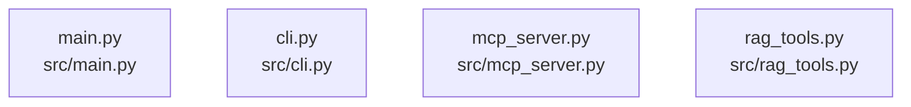

# dependency-map

[解析トップへ戻る](../README.md)

内容確認したソースの静的依存関係。PythonはAST、JavaScript／TypeScriptはimport文の字句抽出です。型だけのimport、再export、コメントや動的importの扱いには制限があり、ランタイム依存の完全なグラフではありません。

## 要素の説明

### n-src-cli-py-d5f3ee

確認済みファイル: `src/cli.py`

解析: Python AST。静的なimport／export参照です。関数の実行順序やHTTP通信は表していません。

宣言: `setup_logging`, `clear_index`, `index_documents`, `get_document_count`, `main`

- `sys` → 外部・標準ライブラリ・別名など。ローカル対応先は未確定
- `os` → 外部・標準ライブラリ・別名など。ローカル対応先は未確定
- `argparse` → 外部・標準ライブラリ・別名など。ローカル対応先は未確定
- `logging` → 外部・標準ライブラリ・別名など。ローカル対応先は未確定
- `pathlib` → 外部・標準ライブラリ・別名など。ローカル対応先は未確定
- `typing` → 外部・標準ライブラリ・別名など。ローカル対応先は未確定
- `dotenv` → 外部・標準ライブラリ・別名など。ローカル対応先は未確定
- `rag_tools` → `src/rag_tools.py`（内容確認済み）

[詳細な図と説明を見る](n-src-cli-py-d5f3ee/README.md)

### n-src-main-py-d1a726

確認済みファイル: `src/main.py`

解析: Python AST。静的なimport／export参照です。関数の実行順序やHTTP通信は表していません。

宣言: `main`

- `sys` → 外部・標準ライブラリ・別名など。ローカル対応先は未確定
- `os` → 外部・標準ライブラリ・別名など。ローカル対応先は未確定
- `argparse` → 外部・標準ライブラリ・別名など。ローカル対応先は未確定
- `importlib` → 外部・標準ライブラリ・別名など。ローカル対応先は未確定
- `logging` → 外部・標準ライブラリ・別名など。ローカル対応先は未確定
- `dotenv` → 外部・標準ライブラリ・別名など。ローカル対応先は未確定
- `mcp_server` → `src/mcp_server.py`（内容確認済み）
- `rag_tools` → `src/rag_tools.py`（内容確認済み）

[詳細な図と説明を見る](n-src-main-py-d1a726/README.md)

### n-src-mcp-server-py-419f34

確認済みファイル: `src/mcp_server.py`

解析: Python AST。静的なimport／export参照です。関数の実行順序やHTTP通信は表していません。

宣言: `MCPServer`

- `sys` → 外部・標準ライブラリ・別名など。ローカル対応先は未確定
- `json` → 外部・標準ライブラリ・別名など。ローカル対応先は未確定
- `logging` → 外部・標準ライブラリ・別名など。ローカル対応先は未確定
- `typing` → 外部・標準ライブラリ・別名など。ローカル対応先は未確定
- `pathlib` → 外部・標準ライブラリ・別名など。ローカル対応先は未確定

[詳細な図と説明を見る](n-src-mcp-server-py-419f34/README.md)

### n-src-rag-tools-py-d8be9c

確認済みファイル: `src/rag_tools.py`

解析: Python AST。静的なimport／export参照です。関数の実行順序やHTTP通信は表していません。

宣言: `register_rag_tools`, `search_handler`, `get_document_count_handler`, `create_rag_service_from_env`

- `os` → 外部・標準ライブラリ・別名など。ローカル対応先は未確定
- `typing` → 外部・標準ライブラリ・別名など。ローカル対応先は未確定
- `document_processor` → `src/document_processor.py`（一覧確認・内容未読）
- `embedding_generator` → `src/embedding_generator.py`（一覧確認・内容未読）
- `vector_database` → `src/vector_database.py`（一覧確認・内容未読）
- `rag_service` → `src/rag_service.py`（一覧確認・内容未読）
- `pgvector_bootstrap` → `src/pgvector_bootstrap.py`（一覧確認・内容未読）
- `dotenv` → 外部・標準ライブラリ・別名など。ローカル対応先は未確定

[詳細な図と説明を見る](n-src-rag-tools-py-d8be9c/README.md)

