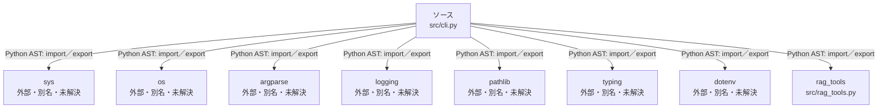

# dependency-map/n-src-cli-py-d5f3ee

[解析トップへ戻る](../../README.md)

確認済みファイル: `src/cli.py`

解析: Python AST。静的なimport／export参照です。関数の実行順序やHTTP通信は表していません。

宣言: `setup_logging`, `clear_index`, `index_documents`, `get_document_count`, `main`

- `sys` → 外部・標準ライブラリ・別名など。ローカル対応先は未確定
- `os` → 外部・標準ライブラリ・別名など。ローカル対応先は未確定
- `argparse` → 外部・標準ライブラリ・別名など。ローカル対応先は未確定
- `logging` → 外部・標準ライブラリ・別名など。ローカル対応先は未確定
- `pathlib` → 外部・標準ライブラリ・別名など。ローカル対応先は未確定
- `typing` → 外部・標準ライブラリ・別名など。ローカル対応先は未確定
- `dotenv` → 外部・標準ライブラリ・別名など。ローカル対応先は未確定
- `rag_tools` → `src/rag_tools.py`（内容確認済み）

## 要素の説明

### n-argparse-e750ee

参照名: `argparse`

ローカルのソース対応先を確定できませんでした。外部ライブラリ、標準ライブラリ、型別名などを区別する追加確認が必要です。

### n-dotenv-4de95c

参照名: `dotenv`

ローカルのソース対応先を確定できませんでした。外部ライブラリ、標準ライブラリ、型別名などを区別する追加確認が必要です。

### n-logging-42f7b0

参照名: `logging`

ローカルのソース対応先を確定できませんでした。外部ライブラリ、標準ライブラリ、型別名などを区別する追加確認が必要です。

### n-os-999a34

参照名: `os`

ローカルのソース対応先を確定できませんでした。外部ライブラリ、標準ライブラリ、型別名などを区別する追加確認が必要です。

### n-pathlib-4471f7

参照名: `pathlib`

ローカルのソース対応先を確定できませんでした。外部ライブラリ、標準ライブラリ、型別名などを区別する追加確認が必要です。

### n-rag-tools-48aafe

参照名: `rag_tools`

対応する実在ソース: `src/rag_tools.py`。内容確認済み。

### n-sys-b4c56e

参照名: `sys`

ローカルのソース対応先を確定できませんでした。外部ライブラリ、標準ライブラリ、型別名などを区別する追加確認が必要です。

### n-typing-02d7d3

参照名: `typing`

ローカルのソース対応先を確定できませんでした。外部ライブラリ、標準ライブラリ、型別名などを区別する追加確認が必要です。

### source

`src/cli.py` の内容を確認しました。

