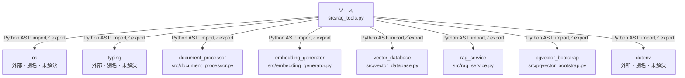

# dependency-map/n-src-rag-tools-py-d8be9c

[解析トップへ戻る](../../README.md)

確認済みファイル: `src/rag_tools.py`

解析: Python AST。静的なimport／export参照です。関数の実行順序やHTTP通信は表していません。

宣言: `register_rag_tools`, `search_handler`, `get_document_count_handler`, `create_rag_service_from_env`

- `os` → 外部・標準ライブラリ・別名など。ローカル対応先は未確定
- `typing` → 外部・標準ライブラリ・別名など。ローカル対応先は未確定
- `document_processor` → `src/document_processor.py`（一覧確認・内容未読）
- `embedding_generator` → `src/embedding_generator.py`（一覧確認・内容未読）
- `vector_database` → `src/vector_database.py`（一覧確認・内容未読）
- `rag_service` → `src/rag_service.py`（一覧確認・内容未読）
- `pgvector_bootstrap` → `src/pgvector_bootstrap.py`（一覧確認・内容未読）
- `dotenv` → 外部・標準ライブラリ・別名など。ローカル対応先は未確定

## 要素の説明

### n-document-processor-0bdfb6

参照名: `document_processor`

対応する実在ソース: `src/document_processor.py`。内容は未読。

### n-dotenv-4de95c

参照名: `dotenv`

ローカルのソース対応先を確定できませんでした。外部ライブラリ、標準ライブラリ、型別名などを区別する追加確認が必要です。

### n-embedding-generator-6697e5

参照名: `embedding_generator`

対応する実在ソース: `src/embedding_generator.py`。内容は未読。

### n-os-999a34

参照名: `os`

ローカルのソース対応先を確定できませんでした。外部ライブラリ、標準ライブラリ、型別名などを区別する追加確認が必要です。

### n-pgvector-bootstrap-0a96f6

参照名: `pgvector_bootstrap`

対応する実在ソース: `src/pgvector_bootstrap.py`。内容は未読。

### n-rag-service-677b26

参照名: `rag_service`

対応する実在ソース: `src/rag_service.py`。内容は未読。

### n-typing-02d7d3

参照名: `typing`

ローカルのソース対応先を確定できませんでした。外部ライブラリ、標準ライブラリ、型別名などを区別する追加確認が必要です。

### n-vector-database-ffcfd3

参照名: `vector_database`

対応する実在ソース: `src/vector_database.py`。内容は未読。

### source

`src/rag_tools.py` の内容を確認しました。

