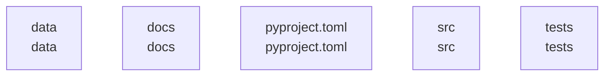

# overall-architecture

[解析トップへ戻る](../README.md)

# mcp-rag-server

MCPサーバー、RAGツール、HTTP／CLI入口を持つPythonプロジェクト。

この図はリポジトリ内の構成です。コードを実行した結果やサービス間の通信保証ではありません。

## 対象と根拠

対象: https://github.com/FORIFOR/mcp-rag-server

取得ブランチ: `main`

Git tree SHA: `1116f228992b67265cf67ef38c26b3e4ea9d160d`

ファイル一覧: 276件。内容確認: 6件。全ファイルの意味解析ではありません。

## 解析の制約

実コードの取得は入口、マニフェスト、直接参照先を中心とする初回解析です。動的ロード、実行時設定、別リポジトリとの接続、ローカル未コミット変更は未確認です。

## 確認が必要な点

構成図の配置関係と、実際の通信・呼び出し関係を区別してください。README上の機能や精度の記述は動作検証済みという意味ではありません。

## 追加解析

未読の中核モジュールから処理順序・データ保存・状態遷移を追加解析する。実行環境で通信先と機能フラグを照合する。

## 補足

2026-10-11の初回解析スナップショットです。現在のコードとの差分や実行環境は追加確認が必要です。

## 要素の説明

### n-data-a17c9a

確認したパス: `data`。配下の登録ファイルは226件。

- `data/conversations/demo/n_0WjGjY7U/local.json`（一覧のみ）
- `data/conversations/demo/n_0cwT_lX4/local.json`（一覧のみ）
- `data/conversations/demo/n_16jNsD_-/local.json`（一覧のみ）
- `data/conversations/demo/n_18Wtc1f-/local.json`（一覧のみ）
- `data/conversations/demo/n_1lS8hciW/local.json`（一覧のみ）
- `data/conversations/demo/n_20rYlF_q/local.json`（一覧のみ）
- `data/conversations/demo/n_2VJZxftm/local.json`（一覧のみ）
- `data/conversations/demo/n_32QVrO85/local.json`（一覧のみ）
- `data/conversations/demo/n_3LO-SapX/local.json`（一覧のみ）
- `data/conversations/demo/n_4EF3lih3/local.json`（一覧のみ）
- `data/conversations/demo/n_52ViMKwz/local.json`（一覧のみ）
- `data/conversations/demo/n_7CeukcTU/local.json`（一覧のみ）
- `data/conversations/demo/n_7okvbLO3/local.json`（一覧のみ）
- `data/conversations/demo/n_89yjB0kY/local.json`（一覧のみ）
- `data/conversations/demo/n_8ioiPT5L/local.json`（一覧のみ）
- `data/conversations/demo/n_9W6i30aG/local.json`（一覧のみ）
- `data/conversations/demo/n_9wkO1gj9/local.json`（一覧のみ）
- `data/conversations/demo/n_A4raX6s5/local.json`（一覧のみ）
- `data/conversations/demo/n_ASYPyvv6/local.json`（一覧のみ）
- `data/conversations/demo/n_A_j3v5uX/local.json`（一覧のみ）
- `data/conversations/demo/n_BTDrONa5/local.json`（一覧のみ）
- `data/conversations/demo/n_Bd2mXBI-/local.json`（一覧のみ）
- `data/conversations/demo/n_Bd9aMvni/local.json`（一覧のみ）
- `data/conversations/demo/n_BxhErNlM/local.json`（一覧のみ）
- `data/conversations/demo/n_CF0Tlr4S/local.json`（一覧のみ）
- `data/conversations/demo/n_CXNIF2Bw/local.json`（一覧のみ）
- `data/conversations/demo/n_CtUkAZJI/local.json`（一覧のみ）
- `data/conversations/demo/n_DxqizCqz/local.json`（一覧のみ）
- `data/conversations/demo/n_EO2OUMMM/local.json`（一覧のみ）
- `data/conversations/demo/n_FE1ARCAE/local.json`（一覧のみ）
- `data/conversations/demo/n_GDMumvbu/local.json`（一覧のみ）
- `data/conversations/demo/n_GKs6UwW_/local.json`（一覧のみ）
- `data/conversations/demo/n_GO-J9yIs/local.json`（一覧のみ）
- `data/conversations/demo/n_GPim12vC/local.json`（一覧のみ）
- `data/conversations/demo/n_GeD6nvDk/local.json`（一覧のみ）

[詳細な図と説明を見る](n-data-a17c9a/README.md)

### n-docs-71ab8b

確認したパス: `docs`。配下の登録ファイルは1件。

- `docs/design.md`（一覧のみ）

### n-pyproject-toml-5d07e7

確認したパス: `pyproject.toml`。配下の登録ファイルは1件。

- `pyproject.toml`（内容確認済み）

### n-src-f27fed

確認したパス: `src`。配下の登録ファイルは31件。

- `src/__init__.py`（一覧のみ）
- `src/cli.py`（内容確認済み）
- `src/config.py`（一覧のみ）
- `src/dependencies.py`（一覧のみ）
- `src/document_processor.py`（一覧のみ）
- `src/embedding_generator.py`（一覧のみ）
- `src/file_storage.py`（一覧のみ）
- `src/http_server.py`（一覧のみ）
- `src/job_store.py`（一覧のみ）
- `src/legacy_logic.py`（一覧のみ）
- `src/llm_router.py`（一覧のみ）
- `src/main.py`（内容確認済み）
- `src/mcp_server.py`（内容確認済み）
- `src/models.py`（一覧のみ）
- `src/nextcloud_client.py`（一覧のみ）
- `src/pdf_utils.py`（一覧のみ）
- `src/pgvector_bootstrap.py`（一覧のみ）
- `src/rag_service.py`（一覧のみ）
- `src/rag_tools.py`（内容確認済み）
- `src/routers/__init__.py`（一覧のみ）
- `src/routers/documents.py`（一覧のみ）
- `src/routers/ingest.py`（一覧のみ）
- `src/routers/jobs.py`（一覧のみ）
- `src/routers/library.py`（一覧のみ）
- `src/routers/notebooks.py`（一覧のみ）
- `src/routers/search.py`（一覧のみ）
- `src/routers/summarize.py`（一覧のみ）
- `src/routers/v1.py`（一覧のみ）
- `src/security.py`（一覧のみ）
- `src/utils.py`（一覧のみ）
- `src/vector_database.py`（一覧のみ）

[詳細な図と説明を見る](n-src-f27fed/README.md)

### n-tests-04d13f

確認したパス: `tests`。配下の登録ファイルは4件。

- `tests/conftest.py`（一覧のみ）
- `tests/test_embedding_generator.py`（一覧のみ）
- `tests/test_mcp_server.py`（一覧のみ）
- `tests/test_vector_database.py`（一覧のみ）

[詳細な図と説明を見る](n-tests-04d13f/README.md)

