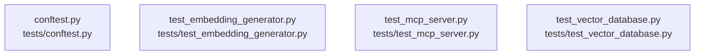

# overall-architecture/n-tests-04d13f

[解析トップへ戻る](../../README.md)

確認したパス: `tests`。配下の登録ファイルは4件。

- `tests/conftest.py`（一覧のみ）
- `tests/test_embedding_generator.py`（一覧のみ）
- `tests/test_mcp_server.py`（一覧のみ）
- `tests/test_vector_database.py`（一覧のみ）

## 要素の説明

### n-tests-conftest-py-626af3

実在パス: `tests/conftest.py`。1ファイル。

- `tests/conftest.py`

### n-tests-test-embedding-generator-py-b03444

実在パス: `tests/test_embedding_generator.py`。1ファイル。

- `tests/test_embedding_generator.py`

### n-tests-test-mcp-server-py-8e4b5e

実在パス: `tests/test_mcp_server.py`。1ファイル。

- `tests/test_mcp_server.py`

### n-tests-test-vector-database-py-017b9b

実在パス: `tests/test_vector_database.py`。1ファイル。

- `tests/test_vector_database.py`

